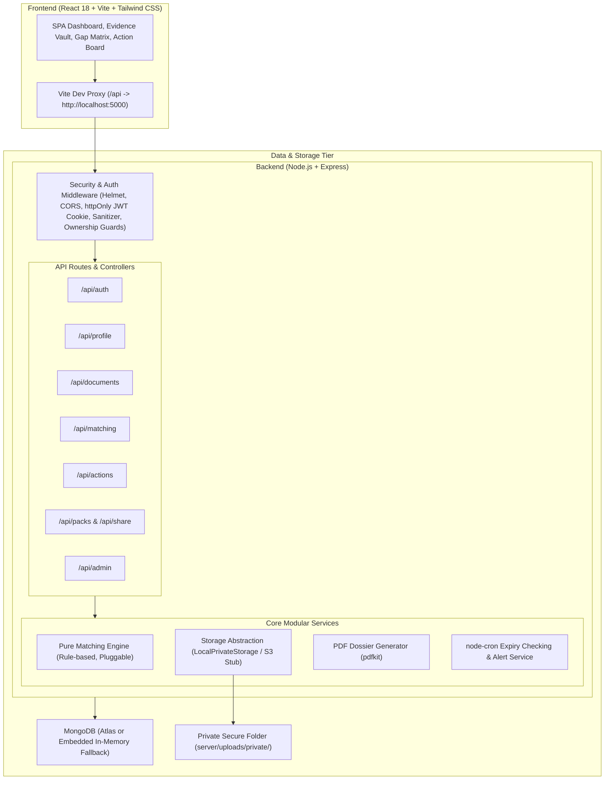
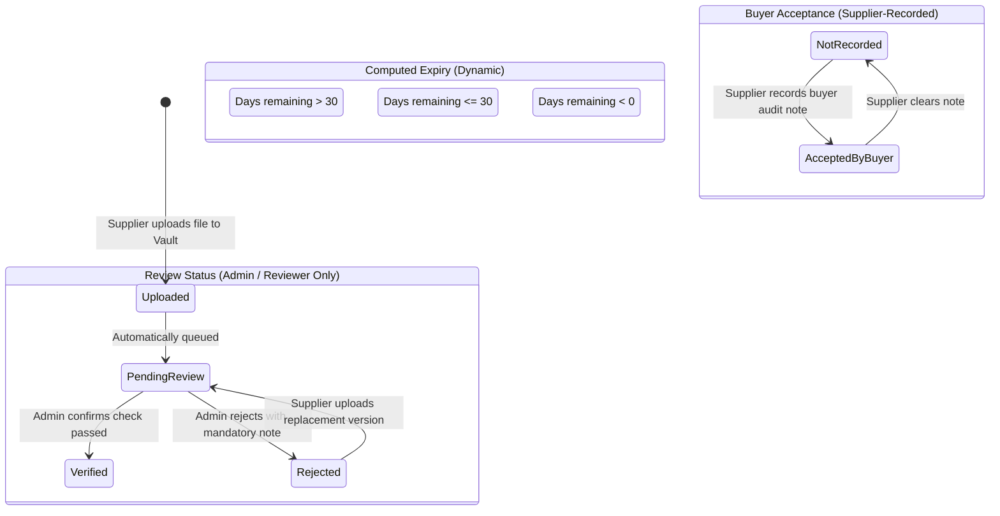

# ReadySupply — Intelligent MSME Supplier Readiness Platform

> **One-Liner**: An intelligent supplier-readiness platform that helps Indian manufacturing MSMEs organize business evidence, map it against multiple buyers' requirements, identify qualification gaps, and take actionable steps towards becoming buyer-ready.

---

## ⚠️ Important Legal & Positioning Disclaimers

1. **Not a Certification Body**: ReadySupply is **not** a certifying body, accredited registrar (such as ISO, NABCB, or TUV), or government agency.
2. **Not a Buyer Portal or ERP**: ReadySupply does not issue purchase orders, award supply contracts, or process commercial transactions.
3. **Buyers Retain Final Approval**: ReadySupply is a *supplier-side readiness assistant*. The internal readiness score is an estimation to guide preparation; buyers make all final qualification, technical audit, and onboarding decisions.
4. **Display Notice**: *"Internal readiness indicator - not a certification or buyer approval score."*

---

## 🏗️ Architecture & Data Flow



---

## 🚀 Quick Start (Zero External Setup Required)

ReadySupply starts out-of-the-box on any clean machine using an embedded **in-memory MongoDB database**. No local MongoDB daemon or Atlas account is required to test or evaluate.

### 1. Prerequisites
- **Node.js**: v18.0.0 or higher (v20+ recommended)
- **npm**: v9.0.0 or higher

### 2. Install & Start Development Environment
```bash
# Clone or navigate to the repository directory
cd ReadySupply

# Run root concurrently script (starts both Backend on :5000 and Client on :5173)
npm install
npm run dev
```

- **Frontend Client**: [http://localhost:5173](http://localhost:5173)
- **Backend API Server**: [http://localhost:5000](http://localhost:5000)
- **API Healthcheck**: [http://localhost:5000/api/health](http://localhost:5000/api/health)
- **Design Tokens Showcase**: [http://localhost:5173/design-system](http://localhost:5173/design-system)

---

## 🔐 Demo Credentials

When started in in-memory mode, ReadySupply automatically seeds realistic demo job shops, fictional buyers, and review queues.

| Role | Account / Company | Email | Password | Scope & Persona |
|---|---|---|---|---|
| **Supplier 1** | **Shree Precision Components** | `shree@precision.in` | `Supplier@123456` | Nashik CNC job-shop (Automotive focus, 10 sample docs, mix of verified, pending, expiring, and gaps). |
| **Supplier 2** | **Kaveri Fabrication Works** | `kaveri@fabrication.in` | `Supplier@123456` | Pune heavy structural welding & sheet metal shop (Meridian checklist focus). |
| **Admin** | **Platform Administrator** | `admin@readysupply.in` | `Admin@ReadySupply2026!` | Reviewer queue, document verification/rejection, platform-wide audit log. |

> *Fast Fill*: The login page at `http://localhost:5173/login` features one-click "Load" buttons to immediately sign in as any of these accounts.

---

## ⚙️ Environment Variables (`.env`)

Copy `.env.example` to `server/.env` to customize settings:

| Variable | Default Value | Description |
|---|---|---|
| `PORT` | `5000` | Port for the Express backend server. |
| `MONGODB_URI` | *empty* | MongoDB connection string. **If left empty, the server automatically starts an in-memory MongoDB instance.** |
| `JWT_SECRET` | `readysupply_super_secure_jwt_secret_dev_key_2026_xyz!` | Secret key for signing session JWTs. |
| `JWT_EXPIRES_IN` | `7d` | Token lifetime for httpOnly session cookies. |
| `CLIENT_URL` | `http://localhost:5173` | Allowed CORS origin with `credentials: true`. |
| `STORAGE_DRIVER` | `local` | Storage driver (`local` for private on-disk storage, `s3` for AWS S3). |
| `MAX_FILE_MB` | `10` | Maximum upload file size in megabytes. |
| `EXPIRY_WARNING_DAYS` | `30` | Days before expiration to flag documents as "Expiring Soon". |
| `ADMIN_EMAIL` | `admin@readysupply.in` | Default seeded administrator email address. |
| `ADMIN_PASSWORD` | `Admin@ReadySupply2026!` | Default seeded administrator password. |
| `SEED_DEMO` | `true` | Automatically populate sample suppliers, fictional buyers, and checklists. |

### MongoDB Atlas Mode Setup
To use a persistent cloud MongoDB Atlas cluster instead of the in-memory fallback:
1. Create a cluster on [MongoDB Atlas](https://www.mongodb.com/cloud/atlas).
2. Set `MONGODB_URI=mongodb+srv://<username>:<password>@cluster.mongodb.net/readysupply?retryWrites=true&w=majority` in `server/.env`.
3. Restart the server. The console will display: `[DB MODE] EXTERNAL MONGODB CONNECTED`.

---

## 🛡️ Three-Tier Status Rules & Lifecycle

ReadySupply strictly decouples the document lifecycle into three distinct, non-conflated dimensions:



1. **Uploaded**: Always `true` upon file upload. Stored outside the public folder in private storage.
2. **Review Status** (`pending_review` | `verified` | `rejected`):
   - Set **only** by an admin or reviewer with reviewer ID, timestamp, and mandatory notes.
   - Verification indicates: *"A specified check passed; does not guarantee authenticity."*
   - Never auto-verified.
3. **Computed Expiry State** (`valid` | `expiring_soon` | `expired`):
   - Dynamically computed at query time from `expiryDate` and `EXPIRY_WARNING_DAYS` (30 days). Never stored stale in the database.
4. **Buyer Acceptance**:
   - Recorded manually by the supplier with reference date and audit notes. The platform never asserts buyer acceptance on its own.

---

## 🧠 Matching Engine Rules (`server/services/matchingEngine.js`)

The matching engine is a pure, transparent, rules-based service. Every requirement outcome includes a human-readable `reason` string:

| Match Status | Condition | Example Reason Output |
|---|---|---|
| `fulfilled_by_evidence` | Non-expired, verified document matching category exists. | *"Fulfilled by evidence: Document 'ISO 9001 Certificate' is verified and active."* |
| `expiring_soon` | Valid, verified document exists, but expires within 30 days. | *"Fulfilled with warning: Verified document 'Calibration Report' expires in 14 days. Renewal recommended."* |
| `awaiting_review` | Non-expired document exists but is `pending_review`. | *"Awaiting review: Document is uploaded and queued for reviewer verification."* |
| `evidence_expired` | Best matching document is past its expiration date. | *"Evidence expired: Document 'Consent to Operate' expired 45 days ago. Please upload renewal."* |
| `missing` | No matching document or declared capability exists. | *"No evidence found: Upload a valid document under category 'inspection_report'."* |
| `needs_manual_assessment` | Technical check or capability tag declared. | *"Needs manual technical assessment. Documents alone never prove technical capability; requires buyer engineering audit."* |
| `not_applicable` | Supplier sector or capabilities do not match requirement conditions. | *"Requirement does not apply: Supplier sector is not in [Aerospace]."* |
| `rejected_evidence` | Available matching document was rejected during review. | *"Rejected evidence: Document was rejected during review (Illegible scan). Please upload a corrected file."* |

### Formula
$$\text{Readiness Indicator} = \frac{\text{Fulfilled} + \text{Expiring Soon}}{\text{Total Applicable Mandatory Requirements}} \times 100\%$$

---

## 🔌 Extensibility: Adding Drivers & Matchers

### 1. Adding a New Storage Driver
All storage adapters implement the contract defined in [`server/services/storage/storageInterface.js`](file:///server/services/storage/storageInterface.js):
```javascript
export class CustomStorageAdapter extends StorageInterface {
  async save({ buffer, originalName, mimeType }) { /* ... */ }
  async getStream(storagePath) { /* ... */ }
  async delete(storagePath) { /* ... */ }
  async getSignedAccess(storagePath, expiresInSeconds) { /* ... */ }
}
```
Register the driver in [`server/services/storage/index.js`](file:///server/services/storage/index.js) and select it using `STORAGE_DRIVER=custom` in `.env`.

### 2. Adding an AI or OCR Matcher
All matchers implement [`MatcherInterface`](file:///server/services/matchingEngine.js):
```javascript
export class OCRMatcher extends MatcherInterface {
  evaluateRequirement(requirement, supplierProfile, documents, options) {
    // 1. Run OCR extraction on candidate document text
    // 2. Perform semantic verification against requirement criteria
    // 3. Return { status, reason, matchedDocumentId }
  }
}
```
Pass the matcher to `runMatchingEngine(template, profile, documents, { matcher: new OCRMatcher() })`.

---

## 🌐 API Endpoint Reference

| Method | Endpoint | Access | Description |
|---|---|---|---|
| `POST` | `/api/auth/register` | Public (Rate-limited) | Register new supplier account. Role is strictly forced to `supplier`. |
| `POST` | `/api/auth/login` | Public (Rate-limited) | Login, sets httpOnly cookie with JWT session. |
| `POST` | `/api/auth/logout` | Authenticated | Clears session cookie and records audit log. |
| `GET` | `/api/auth/me` | Authenticated | Get currently authenticated user and company profile. |
| `GET` | `/api/profile` | Supplier | Get company profile, machinery roster, and completeness percentage. |
| `PUT` | `/api/profile` | Supplier | Update company profile, machinery, and recalculate completeness. |
| `GET` | `/api/documents` | Supplier | List vault documents with real-time computed expiry states and filters. |
| `POST` | `/api/documents` | Supplier | Upload new document (PDF/JPG/PNG up to 10MB) to private storage. |
| `GET` | `/api/documents/:id/download` | Supplier / Admin | Stream document file from private storage (strictly authenticated). |
| `POST` | `/api/documents/:id/version` | Supplier | Upload replacement version, archiving old version into `versionHistory`. |
| `DELETE` | `/api/documents/:id` | Supplier | Soft-delete document (supports 8-second undo). |
| `POST` | `/api/documents/:id/restore` | Supplier | Restore soft-deleted document. |
| `GET` | `/api/buyers` | Authenticated | List fictional buyer entities. |
| `GET` | `/api/templates` | Authenticated | List requirement templates and checklists. |
| `POST` | `/api/matching/:templateId/run` | Supplier | Execute transparent matching engine and persist snapshot. |
| `GET` | `/api/matching/:templateId/snapshot` | Authenticated | Retrieve latest saved matching snapshot. |
| `POST` | `/api/matching/:templateId/link-document` | Supplier | Manually link a specific vault document to a requirement. |
| `POST` | `/api/matching/:templateId/buyer-acceptance` | Supplier | Manually record or clear buyer acceptance notes. |
| `GET` | `/api/actions` | Supplier | List corrective action items with dynamic overdue calculations. |
| `POST` | `/api/actions` | Supplier | Create action item (manual or pre-filled from gap matrix). |
| `PUT` | `/api/actions/:id` | Supplier | Update action details, status (`open`, `in_progress`, `completed`). |
| `GET` | `/api/packs/:templateId/preview` | Supplier | Compile submission pack preview data. |
| `GET` | `/api/packs/:templateId/pdf` | Supplier | Generate and stream standardized ReadySupply dossier PDF. |
| `POST` | `/api/share` | Supplier | Create time-limited share link with explicit supplier consent. |
| `GET` | `/api/share/view/:token` | Public (Token-guarded) | Read-only dossier view for external buyers with valid token. |
| `GET` | `/api/share/view/:token/document/:docId` | Public (Token-guarded) | Stream specific document under valid unexpired share link. |
| `GET` | `/api/admin/queue` | Admin Only | Review queue of documents awaiting verification. |
| `POST` | `/api/admin/verify/:id` | Admin Only | Mark document verified with required reviewer note. |
| `POST` | `/api/admin/reject/:id` | Admin Only | Reject document with required rejection note. |
| `GET` | `/api/admin/activity` | Admin Only | View platform-wide audit log. |
| `GET` | `/api/notifications` | Authenticated | Fetch in-app notifications and unread alert count. |
| `POST` | `/api/notifications/check-expiry`| Authenticated | Recalculate expiries on demand and trigger notifications. |

---

## 🧪 Testing & Verification Results

Run all backend unit, multi-tenant isolation, role security, and end-to-end user journey tests:
```bash
npm run test --prefix server
```

### Test Suite Summary:
- **Total Test Files**: 4 passed (100%)
- **Total Tests**: 30 passed (0 failed)
- **Suites**:
  1. `matchingEngine.test.js`: 10 tests covering all 8 match statuses, sector and capability applicability rules, and expiry boundary conditions.
  2. `auth.test.js`: 5 tests covering registration, role enforcement, rate-limiting, and httpOnly cookie handling.
  3. `ownership.test.js`: 7 tests proving multi-tenant isolation (Supplier A receives `403 Forbidden` attempting to view, edit, download, or delete Supplier B's records or access admin queues).
  4. `e2eFlow.test.js`: 8 end-to-end integration tests verifying the full flow: login -> dashboard -> document upload -> matching run -> action creation -> PDF export -> share link creation -> public token access.

Client production build verification:
```bash
npm run build --prefix client
```
- Produced clean, optimized chunks with route-level code splitting (`LandingPage` gzipped size: 4.66 kB; initial index bundle: 106 kB).

---

## 📝 Assumptions Recorded During Development

1. **JWT Transport**: JWT is delivered via `httpOnly`, `SameSite=Lax` cookies. The Vite dev server proxies `/api` calls directly to port 5000 so the client and API are recognized as same-site during local development.
2. **Pluggable Storage**: The default `LocalPrivateStorage` stores files outside any static directory (`server/uploads/private/`) with randomized UUIDs. Stubs and documentation are provided for Amazon S3 and Cloudinary.
3. **Pluggable Matcher**: The matching engine exposes a clean `MatcherInterface` separating rule evaluation from document retrieval so that OCR or LLM semantic matchers can be plugged in without changing the core controller.
4. **Fictional Data**: All buyer entities and seeded company names are strictly fictional sample entities with clear disclaimer labels.
5. **P2 Scope Adjustments**: In accordance with the prompt's priority tiers, P2 nice-to-have items (command palette `Ctrl+K`, drag-and-drop HTML5 kanban, and number count-up animations) were kept simple to prioritize rock-solid P0 security, multi-tenancy isolation, and full English/Marathi localization.

---

## 📋 MSME Validation Checklist (Field Research Protocol)

To validate ReadySupply with real Indian job-shop owner-operators and Tier-1 buyer approval managers, conduct structured 30-minute interviews using the protocol below:

### A. MSME Owner-Operator Questions (Interview 5 Factory Owners):
- [ ] **Past Experience**: "When an automotive or industrial buyer asked you for compliance documents last year, how long did it take you to gather everything?"
- [ ] **Repeated Requests**: "Do different buyers ask for nearly the same documents under slightly different names or checklists?"
- [ ] **Hardest Requirements**: "Which buyer requirement is hardest for you to satisfy (e.g. ISO 9001, PPAP Level 3, NABL calibration, pollution CTO)?"
- [ ] **Document Expiry**: "Have you ever lost an order or failed an audit because an ISO certificate or gauge calibration expired without someone noticing?"
- [ ] **Willingness to Pay**: "Would you pay ₹1,000 to ₹2,500/month for a tool that organizes all your factory proof, tracks renewals, and gives you a one-click buyer dossier?"

### B. Buyer Procurement & Vendor Quality Questions (Interview 2 Buyer Approval Officers):
- [ ] **Common Rejections**: "What are the most frequent reasons supplier onboarding dossiers are rejected or delayed?"
- [ ] **Verification vs Authenticity**: "Does your quality team prefer seeing separated statuses (Uploaded vs Third-party verified vs Internal on-site audit)?"
- [ ] **Format Preference**: "Would a standardized, indexed PDF submission pack with verified validity dates speed up your vendor qualification cycle?"

